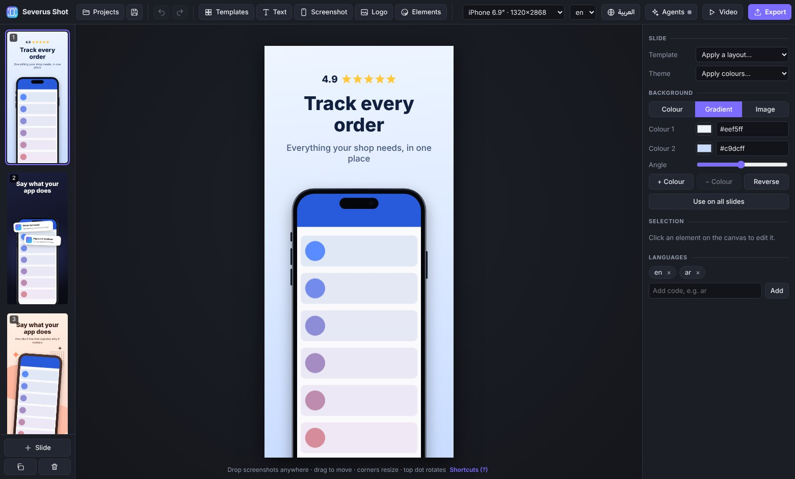
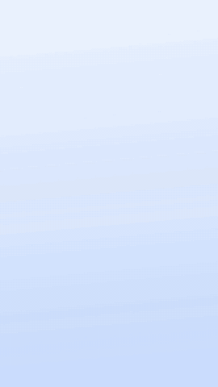

# Severus Shot

**English** · [العربية](#العربية)

Free, open-source desktop app for making App Store and Google Play screenshots and short motion videos.
Runs on macOS, Windows and Linux, with the interface in English and Arabic. Any AI agent that supports MCP can drive it.



| Template gallery | Stickers and shapes | Motion video |
|---|---|---|
|  |  |  |

## Install

1. Open the [latest release](https://github.com/stacxiq/severus-shot/releases/latest).
2. Download the file for your system and open it.

| System | File | First run |
|---|---|---|
| macOS (Apple Silicon and Intel) | `.dmg` | Drag the app to Applications. The app is not signed with an Apple certificate, so the first time **right-click it and choose Open**. |
| Windows 10/11 | `-setup.exe` | If SmartScreen appears, choose **More info > Run anyway**. |
| Linux | `.AppImage` or `.deb` | Make the AppImage executable (`chmod +x`), then run it. |

Prefer one command? It downloads the latest release and installs it:

```bash
# macOS and Linux
curl -fsSL https://raw.githubusercontent.com/stacxiq/severus-shot/main/scripts/install.sh | sh
```

```powershell
# Windows (PowerShell)
irm https://raw.githubusercontent.com/stacxiq/severus-shot/main/scripts/install.ps1 | iex
```

Motion-video export needs [ffmpeg](https://ffmpeg.org) on the computer
(`brew install ffmpeg`, `winget install ffmpeg` or `apt install ffmpeg`). Everything else works without it.

**Status:** version 0.2.0 is an early release. It is developed and tested on Linux and built on macOS; the Windows
build comes from CI and has had the least testing. Please open an issue if something does not work.

## Features

- **Projects:** a library that saves automatically; create, switch and delete projects from one screen.
- **Templates:** 20 layouts in a visual gallery, in 9 colour themes. Applying one keeps your captions and screenshots.
- **Elements:** captions, screenshots in device frames, logos and images, 12 shapes, and 10 ready-made stickers and
  components (star rating, award laurel, feature pill, speech bubble, burst badge, notification card, check line,
  arrow, underline, emoji).
- **Device frames:** phone (island or notch), Android, tablet, clay, outline, glass, frameless, with optional reflection.
- **Fonts:** Inter and IBM Plex Sans Arabic are bundled; any installed font or font file can be used.
- **Backgrounds:** solid colour, multi-colour gradient, or an image with blur and darken.
- **Languages:** one caption per language, exported as one set per language. Arabic and other RTL text is shaped correctly.
- **Export:** every store size at once as flat RGB PNG or JPG, optionally zipped. No watermark.
- **Motion video:** animated H.264 MP4 of your slides (five entrance animations, three transitions).
- **Shortcuts:** press `?` in the app for the full list.

## Command line

```bash
severus-shot export project.severus --out ./out --sizes iphone-6.9,ipad-13 --langs en,ar --zip
severus-shot video  project.severus --out preview.mp4 --size video-1080 --langs en
```

Image sizes: `iphone-6.9`, `iphone-6.7`, `iphone-6.5`, `iphone-5.5`, `ipad-13`, `ipad-12.9`, `android-phone`,
`android-tablet-7`, `android-tablet-10`, or any `WIDTHxHEIGHT`.
Video sizes: `video-1080`, `video-886`, `video-ipad`, `video-square`, or any `WIDTHxHEIGHT`.
On macOS the binary is `Severus Shot.app/Contents/MacOS/severus-shot`. On Linux without a display, use `xvfb-run`.

## AI agents (MCP)

While the app is open it serves MCP at `http://127.0.0.1:47821/mcp` (this computer only; requests from web pages
are refused). The **Agents** button in the app shows ready-to-paste setup for Claude Code, Claude Desktop, Cursor,
VS Code, Codex CLI, Gemini CLI, Windsurf and any other MCP client. Two ways to connect:

- **HTTP:** point the client at the URL above.
- **stdio:** have the client launch `severus-shot mcp`; it starts the app if needed.

Tools: `get_project`, `list_options`, `list_projects`, `new_project`, `open_project`, `save_project`, `list_fonts`,
`load_font`, `set_font`, `add_slide`, `duplicate_slide`, `delete_slide`, `select_slide`, `set_background`,
`apply_template`, `apply_theme`, `add_text`, `add_screenshot`, `add_image`, `add_shape`, `add_sticker`,
`update_element`, `set_text`, `set_languages`, `delete_element`, `reorder_element`, `set_motion`,
`render_preview`, `export`, `export_video`.

Agents can read and write files on the computer through these tools (image paths, export folders), as the app can.
Change the port with `SEVERUS_SHOT_MCP_PORT`.

## Build from source

Requirements: [Rust](https://rustup.rs) and Node.js 18+. Linux also needs `libwebkit2gtk-4.1-dev`, `libgtk-3-dev`,
`librsvg2-dev` and `libsoup-3.0-dev`. Windows needs the MSVC build tools.

```bash
npm install
npm run dev      # run from source
npm run build    # installers in src-tauri/target/release/bundle/
npm test
```

On macOS you can also double-click `Install Severus Shot.command`, which builds and installs in one go.

## Publishing a release

Push a tag such as `v0.2.0`. The workflow in `.github/workflows/release.yml` builds the macOS, Windows and Linux
installers and attaches them to a draft release; review it and press Publish.

## Layout

- `ui/` plain HTML/CSS/JS, no bundler: `model.js` (data, templates), `render.js` (canvas drawing), `motion.js`
  (video timeline), `core.js` (projects, export), `agent.js` (MCP tools), `app.js` and `panels.js` (interface),
  `i18n.js` (Arabic text), `fonts/` (bundled fonts, SIL Open Font License).
- `src-tauri/` Rust: files, fonts, PNG/JPG/ZIP writing, ffmpeg piping, the MCP endpoint and stdio bridge, the CLI.

The design canvas is 1320×2868. Other sizes scale the layout to fit and centre it, so check tablet and square
sizes in the preview before exporting.

## License

[MIT](LICENSE). The bundled fonts (Inter, IBM Plex Sans Arabic) are under the SIL Open Font License.

---

<div dir="rtl">

## العربية

**Severus Shot** تطبيق سطح مكتب مجاني ومفتوح المصدر لصناعة لقطات شاشة متجر App Store و Google Play
ومقاطع فيديو متحركة قصيرة لتطبيقك. يعمل على macOS و Windows و Linux، وواجهته متوفرة بالعربية والإنجليزية،
ويمكن لأي وكيل ذكاء اصطناعي يدعم بروتوكول MCP أن يتحكم به.


### التثبيت

1. افتح صفحة [أحدث إصدار](https://github.com/stacxiq/severus-shot/releases/latest).
2. نزّل الملف المناسب لنظامك ثم افتحه.

| النظام | الملف | عند أول تشغيل |
|---|---|---|
| macOS | `.dmg` | اسحب التطبيق إلى مجلد Applications. التطبيق غير موقّع بشهادة Apple، لذا في أول مرة **انقر عليه بالزر الأيمن واختر Open**. |
| Windows 10/11 | `-setup.exe` | إذا ظهرت نافذة SmartScreen اختر **More info ثم Run anyway**. |
| Linux | `.AppImage` أو `.deb` | اجعل ملف AppImage قابلاً للتنفيذ ثم شغّله. |

أو ثبّته بأمر واحد:

</div>

```bash
# macOS و Linux
curl -fsSL https://raw.githubusercontent.com/stacxiq/severus-shot/main/scripts/install.sh | sh
```

```powershell
# Windows
irm https://raw.githubusercontent.com/stacxiq/severus-shot/main/scripts/install.ps1 | iex
```

<div dir="rtl">

تصدير الفيديو يحتاج إلى [ffmpeg](https://ffmpeg.org) على الحاسوب، وبقية المزايا تعمل بدونه.

### المزايا

- **المشاريع:** مكتبة تحفظ عملك تلقائياً، مع إنشاء المشاريع والتنقل بينها من شاشة واحدة.
- **القوالب:** 20 تخطيطاً في معرض مرئي و9 سمات لونية، وتطبيق القالب يُبقي نصوصك ولقطاتك.
- **العناصر:** نصوص، لقطات داخل إطارات أجهزة، شعارات وصور، 12 شكلاً، و10 ملصقات ومكوّنات جاهزة
  (تقييم بالنجوم، إكليل جائزة، شارة ميزة، فقاعة كلام، بطاقة إشعار وغيرها).
- **إطارات الأجهزة:** هاتف، أندرويد، لوحي، طيني، خط خارجي، زجاجي، وبلا إطار.
- **الخطوط:** خطّا Inter و IBM Plex Sans Arabic مرفقان مع التطبيق، ويمكن استخدام أي خط مثبّت أو ملف خط.
- **اللغات:** نص لكل لغة وتصدير مجموعة لكل لغة، مع دعم صحيح للعربية والكتابة من اليمين إلى اليسار.
- **التصدير:** كل مقاسات المتاجر دفعة واحدة بصيغة PNG أو JPG، مع ملف ZIP اختياري وبلا علامة مائية.
- **الفيديو المتحرك:** فيديو MP4 لشرائحك بخمس حركات دخول وثلاثة انتقالات.
- **الاختصارات:** اضغط `?` داخل التطبيق لعرض القائمة كاملة.
- **وكلاء الذكاء الاصطناعي:** زر «الوكلاء» يعرض إعدادات جاهزة للنسخ لـ Claude و Cursor و VS Code و Codex و Gemini وغيرها.

### الحالة

الإصدار 0.2.0 إصدار مبكر. إذا واجهت مشكلة فافتح بلاغاً في صفحة Issues.

### الرخصة

[MIT](LICENSE)، والخطوط المرفقة برخصة SIL Open Font License.

</div>
