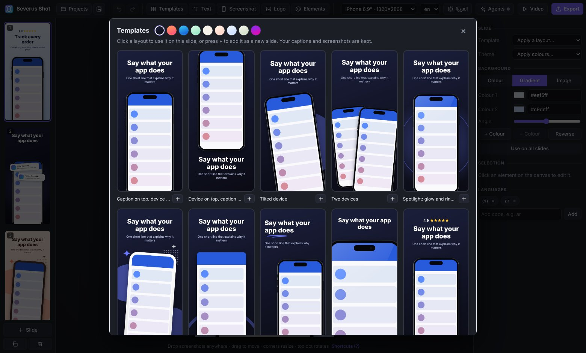
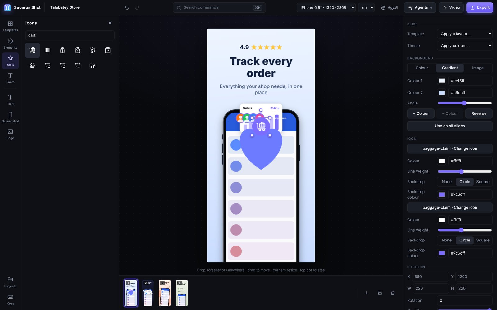
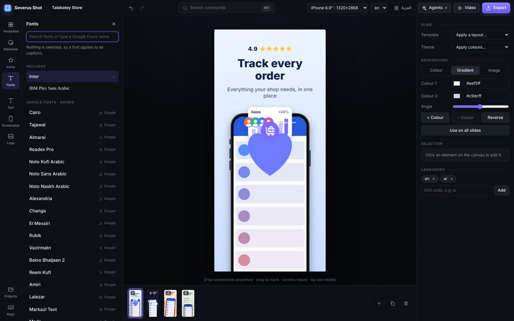
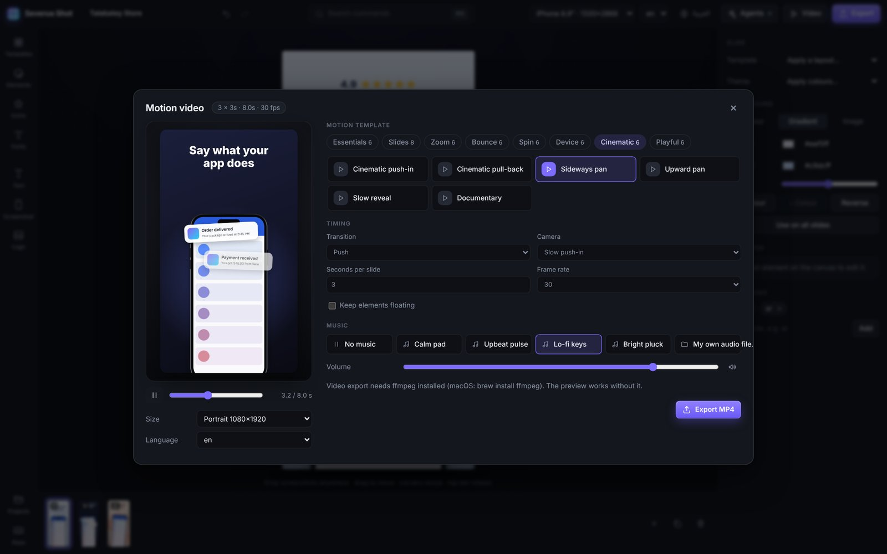
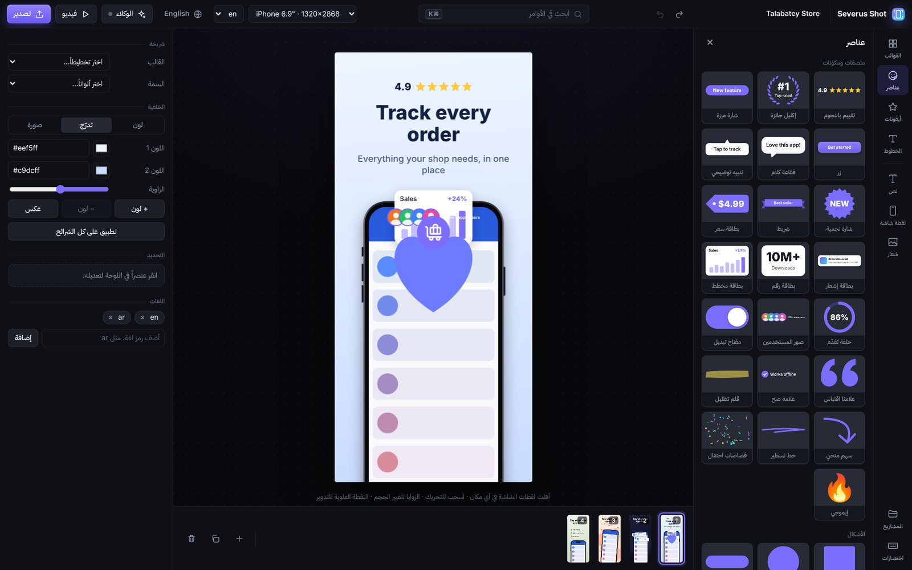

# Severus Shot

**English** · [العربية](#العربية)

Free, open-source desktop app for making App Store and Google Play screenshots and short motion videos.
Runs on macOS, Windows and Linux, with the interface in English and Arabic. Any AI agent that supports MCP can drive it.


| Template gallery | Icon library | Google Fonts |
|---|---|---|
|  |  |  |

| Motion video with music | Example export |
|---|---|
|  |  |

## Install

1. Open the [latest release](https://github.com/stacxiq/severus-shot/releases/latest).
2. Download the file for your system and open it.

| System | File | First run |
|---|---|---|
| macOS (Apple Silicon and Intel) | `.dmg` | Drag the app to Applications. The app is not signed with an Apple certificate, so the first time **right-click it and choose Open**. |
| Windows 10/11 | `-setup.exe` | If SmartScreen appears, choose **More info > Run anyway**. |
| Linux | `.AppImage` or `.deb` | Make the AppImage executable (`chmod +x`), then run it. |

Prefer one command? It downloads the latest release and installs it:

```bash
# macOS and Linux
curl -fsSL https://raw.githubusercontent.com/stacxiq/severus-shot/main/scripts/install.sh | sh
```

```powershell
# Windows (PowerShell)
irm https://raw.githubusercontent.com/stacxiq/severus-shot/main/scripts/install.ps1 | iex
```

Motion-video export needs [ffmpeg](https://ffmpeg.org) on the computer
(`brew install ffmpeg`, `winget install ffmpeg` or `apt install ffmpeg`). Everything else works without it.

**Status:** version 0.4.0 is an early release. It is developed and tested on Linux and built on macOS; the Windows
build comes from CI and has had the least testing. Please open an issue if something does not work.

## Features

- **Projects:** a library that saves automatically; create, rename, switch and delete projects.
- **Templates:** 20 layouts in a visual gallery, in 9 colour themes. Applying one keeps your captions and screenshots.
- **Components:** 22 ready-made stickers (star rating, award laurel, button, callout, ribbon, price tag, stat card,
  chart card, progress ring, user avatars, notification card, confetti and more) and 20 shapes.
- **Icons:** about 2,000 line icons ([Lucide](https://lucide.dev)) with search, colour, line weight and backdrop.
- **Fonts:** Inter and IBM Plex Sans Arabic are bundled. Any Google Fonts family can be downloaded from inside
  the app (a starter list includes 28 Arabic families), and installed fonts or font files work too.
- **Device frames:** phone (island or notch), Android, tablet, clay, outline, glass, frameless, with optional reflection.
- **Backgrounds:** solid colour, multi-colour gradient, or an image with blur and darken.
- **Languages:** one caption per language, exported as one set per language. Arabic and other RTL text is shaped correctly.
- **Export:** every store size at once as flat RGB PNG or JPG, optionally zipped. No watermark.
- **Motion video:** H.264 MP4 from 50 motion templates in 8 groups (essentials, slides, zoom, bounce, spin, device,
  cinematic, playful), 6 transitions, camera moves and optional idle float, with a live preview and scrubber.
  Background music: four built-in tracks (generated by the app, free to use) or your own audio file.
- **Fast to drive:** a command search (`Ctrl/⌘ K`) and single-key shortcuts; press `?` for the list.

## Integrations (new in 0.5)

- **Upload with fastlane.** Export with the *fastlane* layout (or `--layout fastlane`) and the folders are ready for `fastlane deliver` (App Store) and `fastlane supply` (Google Play). The app shows the exact commands after the export.
- **Capture from a simulator or phone.** `Ctrl+Shift+S` lists running iOS simulators, Android emulators and connected Android phones, and drops a fresh screenshot onto the slide, already framed. Needs Xcode for simulators and `adb` for Android.
- **Local AI, free and offline.** `Ctrl+J` translates every caption into another language and suggests new captions with a small model on your own computer. Press **Set up** once: the app downloads its own engine ([llama.cpp](https://github.com/ggml-org/llama.cpp)) and the Gemma 3 1B model (about 830 MB, under the [Gemma terms](https://ai.google.dev/gemma/terms)) into `Documents/Severus Shot/AI` and runs them for you. Nothing else to install. If you already run Ollama or LM Studio, you can point the app at that instead. Small models make mistakes, so read the result before you ship it.
- **Video without Homebrew.** If ffmpeg is missing, the Video window offers a one-time download (a static build from [ffmpeg-static](https://github.com/eugeneware/ffmpeg-static), GPL) into `Documents/Severus Shot/bin`.
- **Update check.** The app tells you when a newer release is on GitHub.

Agents get the same features through MCP: `list_devices`, `capture_device`, `setup_local_ai`, `translate_captions`, `remove_background`, `set_listing`, `install_ffmpeg`, and `layout: "fastlane"` on `export`.

## New in 0.6

- **Remove a background in one click.** Select a logo or product photo and press *Remove background*. A small model (U²-Net) runs on your computer, offline.
- **Store text next to the screenshots.** *Export → Store text…* holds the app name, subtitle, description and keywords per language, with the store limits shown. The local AI can draft and translate them. They are written as fastlane metadata files.
- **Publish from the app.** After a fastlane export, open *Publish to the stores with fastlane*, choose your own App Store Connect API key or Google Play service-account key, and press Publish. Needs [fastlane](https://fastlane.tools) installed. Your key files never leave your computer.
- **Capture a whole flow.** In the capture window press *Series*, then move through your app: every new screen becomes a slide.
- **200,000+ more icons.** The Icons tab can search [Iconify](https://iconify.design) online, including brand logos. Each icon keeps the licence of its own set.
- **Updates install themselves** when the release was built with the project's signing key (maintainers: add the `TAURI_SIGNING_PRIVATE_KEY` repository secret). Otherwise the app opens the download page.

## Command line

```bash
severus-shot export project.severus --out ./out --sizes iphone-6.9,ipad-13 --langs en,ar --zip
severus-shot video  project.severus --out preview.mp4 --size video-1080 --langs en
```

Image sizes: `iphone-6.9`, `iphone-6.7`, `iphone-6.5`, `iphone-5.5`, `ipad-13`, `ipad-12.9`, `android-phone`,
`android-tablet-7`, `android-tablet-10`, or any `WIDTHxHEIGHT`.
Video sizes: `video-1080`, `video-886`, `video-ipad`, `video-square`, or any `WIDTHxHEIGHT`.
On macOS the binary is `Severus Shot.app/Contents/MacOS/severus-shot`. On Linux without a display, use `xvfb-run`.

## AI agents (MCP)

While the app is open it serves MCP at `http://127.0.0.1:47821/mcp` (this computer only; requests from web pages
are refused). The **Agents** button in the app shows ready-to-paste setup for Claude Code, Claude Desktop, Cursor,
VS Code, Codex CLI, Gemini CLI, Windsurf and any other MCP client. Two ways to connect:

- **HTTP:** point the client at the URL above.
- **stdio:** have the client launch `severus-shot mcp`; it starts the app if needed.

Tools: `get_project`, `list_options`, `list_projects`, `new_project`, `open_project`, `save_project`, `list_fonts`,
`load_font`, `set_font`, `add_slide`, `duplicate_slide`, `delete_slide`, `select_slide`, `set_background`,
`apply_template`, `apply_theme`, `add_text`, `add_screenshot`, `add_image`, `add_shape`, `add_sticker`, `add_icon`,
`search_icons`, `add_google_font`,
`update_element`, `set_text`, `set_languages`, `delete_element`, `reorder_element`, `set_motion`,
`render_preview`, `export`, `export_video`.

Agents can read and write files on the computer through these tools (image paths, export folders), as the app can.
Change the port with `SEVERUS_SHOT_MCP_PORT`.

## Build from source

Requirements: [Rust](https://rustup.rs) and Node.js 18+. Linux also needs `libwebkit2gtk-4.1-dev`, `libgtk-3-dev`,
`librsvg2-dev` and `libsoup-3.0-dev`. Windows needs the MSVC build tools.

```bash
npm install
npm run dev      # run from source
npm run build    # installers in src-tauri/target/release/bundle/
npm test
```

On macOS you can also double-click `Install Severus Shot.command`, which builds and installs in one go.

## Publishing a release

Push a tag such as `v0.2.0`. The workflow in `.github/workflows/release.yml` builds the macOS, Windows and Linux
installers and attaches them to a draft release; review it and press Publish.

## Layout

- `ui/` plain HTML/CSS/JS, no bundler: `model.js` (data, templates), `render.js` (canvas drawing), `motion.js`
  (video timeline), `core.js` (projects, export), `agent.js` (MCP tools), `app.js` and `panels.js` (interface),
  `music.js` (built-in tracks), `i18n.js` (Arabic text), `fonts/` (bundled fonts, SIL Open Font License),
  `icons/` (Lucide icons, ISC License).
- `src-tauri/` Rust: files, fonts, PNG/JPG/ZIP writing, ffmpeg piping, the MCP endpoint and stdio bridge, the CLI.

The design canvas is 1320×2868. Other sizes scale the layout to fit and centre it, so check tablet and square
sizes in the preview before exporting.

## Contributors

Created and maintained by [Ali Jasim](https://github.com/stacxiq). See all [Contributors](https://github.com/stacxiq/severus-shot/graphs/contributors).
Issues and pull requests are welcome.

## License

[MIT](LICENSE). The bundled fonts (Inter, IBM Plex Sans Arabic) are under the SIL Open Font License and the
icons (Lucide) under the ISC License. Fonts you download from Google Fonts keep their own open licences.

---

<div dir="rtl">

## العربية

**Severus Shot** تطبيق سطح مكتب مجاني ومفتوح المصدر لصناعة لقطات شاشة متجر App Store و Google Play
ومقاطع فيديو متحركة قصيرة لتطبيقك. يعمل على macOS و Windows و Linux، وواجهته متوفرة بالعربية والإنجليزية،
ويمكن لأي وكيل ذكاء اصطناعي يدعم بروتوكول MCP أن يتحكم به.



### التثبيت

1. افتح صفحة [أحدث إصدار](https://github.com/stacxiq/severus-shot/releases/latest).
2. نزّل الملف المناسب لنظامك ثم افتحه.

| النظام | الملف | عند أول تشغيل |
|---|---|---|
| macOS | `.dmg` | اسحب التطبيق إلى مجلد Applications. التطبيق غير موقّع بشهادة Apple، لذا في أول مرة **انقر عليه بالزر الأيمن واختر Open**. |
| Windows 10/11 | `-setup.exe` | إذا ظهرت نافذة SmartScreen اختر **More info ثم Run anyway**. |
| Linux | `.AppImage` أو `.deb` | اجعل ملف AppImage قابلاً للتنفيذ ثم شغّله. |

أو ثبّته بأمر واحد:

</div>

```bash
# macOS و Linux
curl -fsSL https://raw.githubusercontent.com/stacxiq/severus-shot/main/scripts/install.sh | sh
```

```powershell
# Windows
irm https://raw.githubusercontent.com/stacxiq/severus-shot/main/scripts/install.ps1 | iex
```

<div dir="rtl">

تصدير الفيديو يحتاج إلى [ffmpeg](https://ffmpeg.org) على الحاسوب، وبقية المزايا تعمل بدونه.

### المزايا

- **المشاريع:** مكتبة تحفظ عملك تلقائياً، مع إنشاء المشاريع والتنقل بينها من شاشة واحدة.
- **القوالب:** 20 تخطيطاً في معرض مرئي و9 سمات لونية، وتطبيق القالب يُبقي نصوصك ولقطاتك.
- **المكوّنات:** 22 ملصقاً جاهزاً (تقييم بالنجوم، إكليل جائزة، زر، شريط، بطاقة سعر، بطاقة مخطط، حلقة تقدّم،
  صور مستخدمين، بطاقة إشعار وغيرها) و20 شكلاً.
- **الأيقونات:** نحو 2000 أيقونة مع بحث وتحكم باللون والسُمك والخلفية.
- **إطارات الأجهزة:** هاتف، أندرويد، لوحي، طيني، خط خارجي، زجاجي، وبلا إطار.
- **الخطوط:** خطّا Inter و IBM Plex Sans Arabic مرفقان مع التطبيق، ويمكن تنزيل أي خط من Google Fonts من داخل
  التطبيق (القائمة الجاهزة تضم 28 خطاً عربياً)، إضافةً إلى الخطوط المثبّتة وملفات الخطوط.
- **اللغات:** نص لكل لغة وتصدير مجموعة لكل لغة، مع دعم صحيح للعربية والكتابة من اليمين إلى اليسار.
- **التصدير:** كل مقاسات المتاجر دفعة واحدة بصيغة PNG أو JPG، مع ملف ZIP اختياري وبلا علامة مائية.
- **الفيديو المتحرك:** فيديو MP4 لشرائحك من 50 قالب حركة في 8 مجموعات مع ستة انتقالات وحركات كاميرا ومعاينة
  حيّة، وموسيقى خلفية: أربعة مقاطع جاهزة يولّدها التطبيق أو ملف صوتي من عندك.
- **الاختصارات:** اضغط `?` داخل التطبيق لعرض القائمة كاملة.
- **وكلاء الذكاء الاصطناعي:** زر «الوكلاء» يعرض إعدادات جاهزة للنسخ لـ Claude و Cursor و VS Code و Codex و Gemini وغيرها.

### الإضافات (جديد في 0.5)

- **الرفع عبر fastlane:** صدّر بتخطيط *fastlane* فتصبح المجلدات جاهزة لأمري `fastlane deliver` (App Store) و `fastlane supply` (Google Play).
- **الالتقاط من المحاكي أو الهاتف:** `Ctrl+Shift+S` يلتقط لقطة من محاكي iOS أو محاكي Android أو هاتف Android موصول ويضعها على الشريحة داخل إطار الجهاز.
- **ذكاء اصطناعي محلي ومجاني:** `Ctrl+J` يترجم كل العناوين ويقترح عناوين جديدة بنموذج صغير يعمل على حاسوبك. اضغط **إعداد** مرة واحدة فينزّل التطبيق المحرك والنموذج (Gemma 3 1B، نحو 830 ميغابايت) ويشغّلهما بنفسه دون تثبيت أي شيء آخر. النماذج الصغيرة تخطئ، فراجع النتيجة.
- **فيديو بدون Homebrew:** إن لم يكن ffmpeg مثبتاً، تعرض نافذة الفيديو تنزيله مرة واحدة.
- **التحقق من التحديثات:** يخبرك التطبيق عند صدور إصدار أحدث على GitHub.

### جديد في 0.6

- **إزالة الخلفية بنقرة:** حدّد شعاراً أو صورة منتج واضغط «إزالة الخلفية». يعمل نموذج صغير على حاسوبك دون إنترنت.
- **نصوص المتجر مع اللقطات:** اسم التطبيق والعنوان الفرعي والوصف والكلمات المفتاحية لكل لغة، ويمكن للذكاء المحلي صياغتها وترجمتها.
- **النشر من التطبيق:** بعد التصدير بتخطيط fastlane اختر ملف مفتاحك واضغط «نشر». يحتاج إلى fastlane مثبتاً.
- **التقاط مسار كامل:** اضغط «سلسلة» وتنقّل في تطبيقك فتصبح كل شاشة جديدة شريحة.
- **أكثر من 200,000 أيقونة إضافية** عبر Iconify من تبويب الأيقونات (يحتاج إلى الإنترنت).
- **التحديث التلقائي** عندما يُبنى الإصدار بمفتاح توقيع المشروع.

### الحالة

الإصدار 0.4.0 إصدار مبكر. إذا واجهت مشكلة فافتح بلاغاً في صفحة Issues.

### المساهمون

أنشأه ويشرف عليه [علي جاسم](https://github.com/stacxiq). قائمة [المساهمين](https://github.com/stacxiq/severus-shot/graphs/contributors) كاملة على GitHub، ونرحّب بالبلاغات وطلبات الدمج.

### الرخصة

[MIT](LICENSE)، والخطوط المرفقة برخصة SIL Open Font License.

</div>
